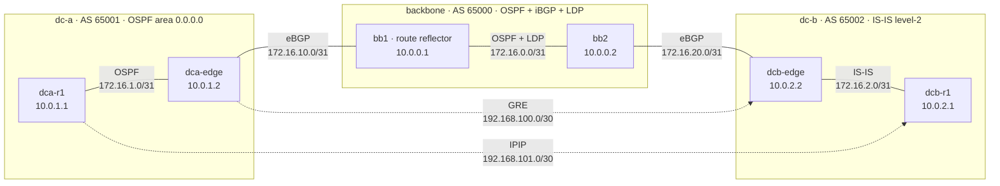

# netlab

A six-router lab built with [containerlab](https://containerlab.dev) and [FRRouting](https://frrouting.org) 10.2.1, plus a typed Python toolkit that renders the configs, polls the live control plane, and repairs it when it drifts.

Two sites, `dc-a` and `dc-b`, each run their own interior gateway protocol and originate their loopbacks into BGP. A two-router backbone carries those routes between them over eBGP at the edges and iBGP inside, with `bb1` as the route reflector. LDP runs on the backbone link. A GRE tunnel and an IP-in-IP tunnel are configured between the sites.

The GRE tunnel, the IP-in-IP tunnel, and MPLS forwarding are configured in this lab and were not run live. The host kernel used for the live run has no GRE, IPIP, or MPLS drivers, so the tunnel interfaces could not be created and packets could not be label-switched. LDP's control plane did come up. Details are in [What was configured but not run live](#what-was-configured-but-not-run-live).

## Topology



| Link | Subnet | Protocols |
|---|---|---|
| dca-r1 `eth1` — dca-edge `eth1` | 172.16.1.0/31 | OSPF area 0, point-to-point |
| dca-edge `eth2` — bb1 `eth1` | 172.16.10.0/31 | eBGP 65001 ↔ 65000 |
| bb1 `eth2` — bb2 `eth1` | 172.16.0.0/31 | OSPF area 0, point-to-point, LDP |
| bb2 `eth2` — dcb-edge `eth2` | 172.16.20.0/31 | eBGP 65000 ↔ 65002 |
| dcb-edge `eth1` — dcb-r1 `eth1` | 172.16.2.0/31 | IS-IS level-2, point-to-point |
| dca-edge — dcb-edge `gre-ab` | 192.168.100.0/30 | GRE, endpoints 10.0.1.2 and 10.0.2.2 |
| dca-r1 — dcb-r1 `ipip-ab` | 192.168.101.0/30 | IP-in-IP, endpoints 10.0.1.1 and 10.0.2.1 |

Loopbacks are the router IDs. `bb1` reflects routes to `bb2` (`neighbor 10.0.0.2 route-reflector-client`, cluster-id `10.0.0.1`) and rewrites the next hop (`next-hop-self`), so the backbone IGP only has to carry the two loopbacks. Each edge originates its site's loopbacks with `network` statements and injects a default into its IGP (`default-information originate`), so the interior routers reach the other site without learning BGP themselves. eBGP sessions are filtered both ways by prefix-list `PL-LAB-PREFIXES` (`10.0.0.0/8 le 32`) through route-maps `RM-EBGP-IN` and `RM-EBGP-OUT`.

Timers are short on purpose: BGP keepalive 3 / hold 9, OSPF hello 1 / dead 4, IS-IS hello 1 with a multiplier of 3. That keeps failure detection inside a few seconds.

Everything above is generated from [`lab/network.yml`](lab/network.yml). The intended operational state the monitor checks against is [`lab/intended_state.yml`](lab/intended_state.yml).

## What was configured but not run live

The GRE tunnel (`gre-ab`, 192.168.100.0/30), the IP-in-IP tunnel (`ipip-ab`, 192.168.101.0/30), and MPLS forwarding are part of the lab configuration. None of the three was run live, because of kernel limits on the machine where the lab was deployed:

- **GRE and IP-in-IP.** Both tunnels are declared in `lab/network.yml`, and `netlab up` builds the `ip link add type gre` and `type ipip` commands for them. On this kernel those commands return `Unknown device type` (`sit`, `gretap`, `vxlan`, and `geneve` fail the same way). Containers share the host kernel, so the interfaces were never created and no packet was encapsulated. The deploy probe records that in `build/capabilities.json` and skips tunnel creation instead of failing the lab. On a kernel with `ip_gre` and `ipip` loaded, the same command creates both tunnels and the monitor starts pinging `192.168.100.2` and `192.168.101.2`.
- **MPLS forwarding.** Both backbone routers are configured for LDP (`mpls ldp` in the rendered FRR config, on the 172.16.0.0/31 link). `ldpd` ran and the neighbor reached `OPERATIONAL`, with label 16 for `10.0.0.2/32`. Forwarding on those labels did not run: `/proc/sys/net/mpls` does not exist here, so the kernel cannot impose or switch labels. Loading `mpls_router` and `mpls_iptunnel` and setting `net.mpls.platform_labels` is what it would take to forward on the labels LDP already allocated.

## What did run live

Deployed and verified on this machine (Linux 6.12.94+, Docker 29.9.0, containerlab 0.81.0, FRR 10.2.1):

- OSPF adjacency `dca-edge` ↔ `dca-r1` in state `Full/-`
- IS-IS adjacency `dcb-edge` ↔ `dcb-r1` in state `Up`, level 2
- both eBGP sessions and the iBGP session `Established`; `bb2` learns `10.0.1.1/32` and `10.0.1.2/32` as reflected routes (`*>i`, next hop `10.0.0.1`)
- LDP neighbor `10.0.0.2` in state `OPERATIONAL`, with label 16 allocated for `10.0.0.2/32` and implicit-null for local prefixes
- traceroute from `10.0.1.1` to `10.0.2.1` crossing all five hops, and a ping at 0.091 ms

The raw command output is in [`docs/captured/`](docs/captured).

## Automation

```
lab/network.yml ──render──▶ build/configs/<router>/{frr.conf,daemons,vtysh.conf}
                         └─▶ build/netlab.clab.yml ──containerlab──▶ six containers
lab/intended_state.yml ──▶ monitor polls `vtysh -c 'show ... json'` over `docker exec`
                         └─▶ findings ──▶ root-cause plan ──▶ fix, or an escalation
```

| Command | What it does |
|---|---|
| `netlab render` | Render configs and the containerlab topology into `build/` |
| `netlab up` | Render, `containerlab deploy`, probe kernel capabilities, create tunnels the kernel allows |
| `netlab down` | `containerlab destroy --cleanup` |
| `netlab push [router]` | Stream the rendered config in and apply it with `frr-reload.py` |
| `netlab drift [router]` | `frr-reload.py --test` against the rendered config; prints lines to add and delete |
| `netlab check` | One poll: BGP, OSPF, IS-IS, LDP, routes, pings, printed against the intent file |
| `netlab monitor` | Poll loop. Logs JSON to `var/monitor.jsonl`, writes `var/status.json`, serves Prometheus metrics on `:9469` |
| `netlab chaos <scenario\|all>` | Inject a failure, watch the daemon's log, record MTTD and MTTR |
| `netlab report` | Summarize `results/chaos-results.jsonl` |

The monitor reads `show interface`, `show ip route`, `show bgp summary`, `show bgp neighbors`, `show ip ospf neighbor`, `show isis neighbor` and `show mpls ldp neighbor`, all with `json`. It compares that to `lab/intended_state.yml` and pings the far loopback from `dca-r1`.

Remediation is layered, and only the lowest failing layer is acted on. A shut interface explains the BGP sessions, missing routes and failed ping above it, so those are logged as symptoms and left alone.

| What it sees | Root cause it logs | What it does |
|---|---|---|
| Interface administratively down | The interface was shut; names the link partner that lost carrier | `ip link set <if> up` |
| Interface up on both ends but no carrier | Physical or veth fault | Escalates, does not guess |
| Tunnel interface missing | Deleted or never created | Recreates that tunnel |
| BGP neighbor absent, or the wrong route-map | Config drift, with the `frr-reload --test` diff attached as evidence | `netlab push` on that router; a route-map change is followed by `clear bgp ... soft` |
| BGP session down, links up, config in sync | Stale session | `clear bgp ipv4 unicast <peer>` once per session |
| IGP or LDP adjacency down, nothing else wrong | No safe fix | Escalates |
| Routes or pings failing while sessions are up | Re-renders every router and pushes whichever one drifted | `netlab push`, or escalates if none drifted |

Guardrails: a fix is not repeated inside a cooldown (30 s) or past three attempts, and the daemon waits out a settle window (12 s) before planning again. A lower-layer finding preempts that window, so discovering a shut interface a poll later is not stuck behind a fix that was aimed at a symptom. Session and reachability findings have to be seen twice before they are acted on, because one poll can straddle the failure: the interface read happens before the shut and the BGP read after it, which looks like a session problem with a healthy link.

Escalations are logged at error level with the evidence and never turn into commands.

## Running it

Requires Docker, containerlab, and Python 3.10 or newer. The daemon shells out to `docker` and `containerlab`, and uses `sudo -n` for containerlab when it is not root.

```bash
python3 -m venv .venv
.venv/bin/pip install -e '.[dev]'

.venv/bin/netlab up          # render, deploy, probe, build tunnels
.venv/bin/netlab check       # exits 0 when live state matches lab/intended_state.yml

.venv/bin/netlab monitor --interval 1          # leave running; metrics on :9469/metrics
.venv/bin/netlab chaos all --repeat 3          # second terminal, with the monitor up
.venv/bin/netlab report

.venv/bin/netlab down
```

`chaos` refuses to inject anything until `var/status.json` has reported healthy for a few seconds, so it fails fast if the monitor is not running. Scenarios are `link-down`, `config-delete`, `bad-route-map`, or `all`. Each run is appended to `results/chaos-results.jsonl`.

For the tunnels and MPLS forwarding, load the modules before `netlab up`:

```bash
sudo modprobe ip_gre ipip mpls_router mpls_iptunnel
```

### Tests

```bash
.venv/bin/ruff check .
.venv/bin/ruff format --check .
.venv/bin/pytest
```

GitHub Actions runs ruff on 3.12 and pytest on 3.10 and 3.12 ([`.github/workflows/ci.yml`](.github/workflows/ci.yml)). The tests cover config rendering, the lab model's validation, parsing of JSON captured from this lab's FRR, the intent checks, remediation planning and its guardrails, and the monitor loop driven by a fake collector. Nothing in the test suite needs Docker.

## Sample session

Bring-up, trimmed from [`docs/captured/netlab-up.txt`](docs/captured/netlab-up.txt). The capability probe runs after containerlab's deploy:

```
$ netlab up
21:38:08 INFO Containerlab started version=0.81.0
21:38:08 INFO Creating docker network name=netlab-mgmt IPv4 subnet=172.20.20.0/24
21:38:09 INFO Created link: dca-r1:eth1 ▪┄┄▪ dca-edge:eth1
21:38:09 INFO Created link: dca-edge:eth2 ▪┄┄▪ bb1:eth1
21:38:09 INFO Created link: bb1:eth2 ▪┄┄▪ bb2:eth1
21:38:09 INFO Created link: bb2:eth2 ▪┄┄▪ dcb-edge:eth2
21:38:09 INFO Created link: dcb-edge:eth1 ▪┄┄▪ dcb-r1:eth1
WARNING netlab.lab: kernel lacks gre tunnel support: Error: Unknown device type.
WARNING netlab.lab: kernel lacks ipip tunnel support: Error: Unknown device type.
WARNING netlab.lab: kernel lacks MPLS forwarding (no /proc/sys/net/mpls); LDP runs control-plane only
lab up; kernel capabilities: gre=False ipip=False mpls_forwarding=False
```

About twenty seconds later, from [`docs/captured/show-commands.txt`](docs/captured/show-commands.txt):

```
$ docker exec clab-netlab-bb2 vtysh -c 'show ip bgp'
     Network          Next Hop            Metric LocPrf Weight Path
 *>i 10.0.1.1/32      10.0.0.1                 0    100      0 65001 i
 *>i 10.0.1.2/32      10.0.0.1                 0    100      0 65001 i
 *>  10.0.2.1/32      172.16.20.0              0             0 65002 i
 *>  10.0.2.2/32      172.16.20.0              0             0 65002 i

$ docker exec clab-netlab-bb1 vtysh -c 'show mpls ldp neighbor'
AF   ID              State       Remote Address    Uptime
ipv4 10.0.0.2        OPERATIONAL 10.0.0.2        00:00:36

$ docker exec clab-netlab-dca-r1 traceroute -s 10.0.1.1 -q1 -w1 10.0.2.1
 1  172.16.1.1 (172.16.1.1)  0.004 ms
 2  172.16.10.1 (172.16.10.1)  0.009 ms
 3  172.16.0.1 (172.16.0.1)  0.012 ms
 4  172.16.20.0 (172.16.20.0)  0.011 ms
 5  10.0.2.1 (10.0.2.1)  0.010 ms
```

`netlab check` then reports every session up and `all checks pass`.

With `netlab monitor --interval 1` running, one pass of each failure from [`docs/captured/chaos-run.txt`](docs/captured/chaos-run.txt):

```
$ netlab chaos all --repeat 10
[1/10] link-down: shut dca-edge eth2 (DC-A uplink to the backbone)
    detected 0.26s  diagnosed 1.96s  remediated 1.99s  recovered (MTTR) 4.46s
    root cause: dca-edge:eth2 was shut (admin down); link partner bb1:eth1 lost carrier. Adjacencies and sessions over this link drop, and routes learned across it are withdrawn
[1/10] config-delete: delete the eBGP neighbor to dcb-edge from bb2's running config
    detected 1.16s  diagnosed 1.30s  remediated 1.50s  recovered (MTTR) 5.03s
    root cause: BGP neighbor 172.16.20.0 (dcb-edge) was deleted from the running config: config drift from intended state
[1/10] bad-route-map: attach a deny-all inbound route-map to bb1's eBGP session with dca-edge
    detected 0.40s  diagnosed 0.53s  remediated 0.77s  recovered (MTTR) 1.42s
    root cause: BGP neighbor 172.16.10.0 (dca-edge) has an unexpected route-map (in=RM-CHAOS-DENY out=RM-EBGP-OUT, expected in=RM-EBGP-IN out=RM-EBGP-OUT): config drift from intended state
```

Three lines from the monitor log for that link shut, verbatim from [`docs/captured/link-down-events.jsonl`](docs/captured/link-down-events.jsonl):

```json
{"ts": "2026-10-12T21:32:42.671+00:00", "epoch": 1791840762.672, "level": "warning", "logger": "netlab.monitor", "event": "incident_opened", "incident": "8dc113fa"}
{"ts": "2026-10-12T21:32:44.407+00:00", "epoch": 1791840764.408, "level": "warning", "logger": "netlab.monitor", "event": "remediation_applied", "incident": "8dc113fa", "plan": "interface_up:dca-edge:eth2", "ok": true, "results": [{"action": "interface_up", "router": "dca-edge", "target": "eth2", "ok": true, "detail": ""}], "elapsed_s": 0.029}
{"ts": "2026-10-12T21:32:46.873+00:00", "epoch": 1791840766.874, "level": "info", "logger": "netlab.monitor", "event": "incident_resolved", "incident": "8dc113fa", "duration_s": 4.223, "actions": ["interface_up:dca-edge:eth2"], "root_causes": ["dca-edge:eth2 was shut (admin down); link partner bb1:eth1 lost carrier. Adjacencies and sessions over this link drop, and routes learned across it are withdrawn"]}
```

Detection is the first `finding_detected`. Recovery is `incident_resolved`, which waits until the withdrawn routes and the failing ping have all come back, so the number includes reconvergence and not just the fix command.

## Measured results

Thirty injections against the running lab, ten of each scenario, all thirty recovered and all thirty blamed the router that was actually changed. Source: [`results/chaos-results.jsonl`](results/chaos-results.jsonl), summarized by `netlab report`.

| scenario | runs | recovered | correct root cause | MTTD mean / max (s) | MTTR mean / p50 / max (s) |
|---|---|---|---|---|---|
| link-down | 10 | 10 | 10/10 | 0.86 / 1.17 | 3.87 / 3.62 / 4.51 |
| config-delete | 10 | 10 | 10/10 | 0.73 / 1.16 | 4.23 / 4.26 / 5.03 |
| bad-route-map | 10 | 10 | 10/10 | 0.32 / 0.40 | 1.31 / 1.34 / 1.42 |

An earlier batch of fifteen runs ([`results/chaos-results-before-race-fix.jsonl`](results/chaos-results-before-race-fix.jsonl)) also recovered every time, but two of the link-down runs took 15.1 s and 16.1 s. In both, the poll that caught the failure read `dca-edge`'s interfaces before the shut landed and its BGP state after, so the daemon cleared a BGP session that was only down because its interface was about to be reported shut, then waited out the settle window before bringing the link back. Session findings now have to persist for two polls, and a lower-layer cause skips the settle window. The table above is from the run after that change; the slow path did not recur.

## What I learned

A router here is a Linux process forwarding packets. `ip_forward` is on in every container, and containerlab's veth pairs are ordinary Ethernet, so the first thing a packet needs is an ARP entry for whatever is on-link. Past that, forwarding is a routing-table lookup per hop: traceroute from `10.0.1.1` to `10.0.2.1` prints `172.16.1.1`, `172.16.10.1`, `172.16.0.1`, `172.16.20.0`, then the destination, which is the address of the interface each router received the expiring packet on. Nothing in the path rewrites the source or destination. Each router only swaps the layer-2 header and decrements TTL.

The addresses are chosen so that lookup stays unambiguous. Inter-router links are `/31`s (both addresses usable, no broadcast address, and no room for a third speaker), and loopbacks are `/32`s. Advertising a `/32` lets the rest of the network reach that exact router without also advertising a subnet that other routers might already own. Connected routes outrank everything learned, which is why a router never tries to reach its own addresses through a protocol route.

OSPF and IS-IS do the same job and I wanted both on the page. Each floods link-state information and runs SPF, so every router in the site computes the same topology instead of trusting its neighbors' routing tables. OSPF in `dc-a` is one backbone area with `ip ospf network point-to-point` on the `/31`: a two-router segment has nothing to elect a designated router for, and point-to-point skips that. IS-IS in `dc-b` is level-2 only, because there is a single area; the NET `49.0002.0100.0000.2002.00` is the area address plus the system ID plus the selector, and the system ID is what shows up as the adjacency name. Both protocols get a default injected by the edge (`default-information originate` in OSPF, `default-information originate ipv4 level-2` in IS-IS), so `dca-r1` and `dcb-r1` can reach other sites through their edge without running BGP. Loopbacks are passive: the prefix is advertised, but no adjacency is attempted on an interface that has no neighbor.

BGP is what crosses the boundary, and it carries prefixes plus attributes rather than topology. The two edges speak eBGP with the backbone and originate their site's loopbacks with `network` statements. I deliberately did not redistribute the IGP into BGP or BGP into the IGP. Redistribution needs a route-map to stop a route from re-entering the protocol it came from; origination at the edge plus a default into the IGP keeps each protocol's scope obvious. Inside AS 65000 the two backbone routers speak iBGP, and iBGP's split horizon is the part that bites: a route learned from an iBGP peer is not advertised to another iBGP peer, which is what makes a full mesh necessary as the AS grows. With two routers a mesh is trivial, so `bb1` is a route reflector instead, with its cluster-id set so a reflected route can be recognized if it loops. `next-hop-self` on that session matters just as much. Without it, `bb2` would see `10.0.1.1/32` with a next hop of `172.16.10.0`, an address its OSPF instance does not know, and the route would be unusable. With it, the next hop is `10.0.0.1`, which OSPF can resolve recursively to `172.16.0.0` on the backbone link. That recursion is visible in the RIB: one nexthop flagged recursive, and a second one that actually points out an interface.

The route-maps are where policy and reachability come apart. `RM-EBGP-IN` and `RM-EBGP-OUT` permit only `10.0.0.0/8 le 32`, so neither site can inject an arbitrary prefix into the other. Replacing the inbound map with a `deny` sequence, which is what the `bad-route-map` scenario does, leaves the session `Established`. The BGP state machine tracks TCP connectivity and timers, not whether any routes survived policy. The evidence is elsewhere: `pfxRcd` drops to 0 and the downstream routers lose the prefix. Checking session state alone would have reported that failure as healthy, which is why the intent file names the route-map each neighbor must have.

The tunnels are the same idea one layer down. GRE (IP protocol 47) and IP-in-IP (IP protocol 4) both take a packet that is already routed and put it inside another IP packet whose source and destination are the router loopbacks. Those loopbacks are reachable through the underlay built above, so the tunnel rides on top of OSPF, IS-IS and BGP rather than replacing them. GRE adds its own small header and can carry things other than IPv4; IP-in-IP has no extra header and carries IPv4 only. This kernel ships with neither driver, and since every container shares the host kernel, no amount of configuration inside FRR can create the interface. Probing for the device type and skipping it keeps the lab deployable here and fully wired on a machine that has the modules.

MPLS splits the same way. LDP hands out a label per IGP prefix, and `ldpd` did that: the neighbor reached `OPERATIONAL` and `10.0.0.2/32` got label 16, while prefixes local to `bb1` are advertised as implicit-null so the neighbor pops the label itself instead of forwarding the packet back. Forwarding on those labels is a kernel feature, and this kernel has no `/proc/sys/net/mpls`, so the data plane stays unlabeled IP. The control plane was still worth running, because the session, the transport address and the bindings are exactly the pieces that break in practice while the IGP looks fine.

The monitoring side taught me more about observation than about protocols. `vtysh ... json` is a stable interface, but one poll is not an atomic snapshot: the commands run one after another, and a failure injected in between shows up as a contradictory report. Acting on the first contradiction made the repair slower, which is the opposite of what a remediation loop is for. Confirming session-level findings over a second poll, and letting a link-level finding interrupt a fix aimed at a symptom, is what brought the worst case back in line with the median.
